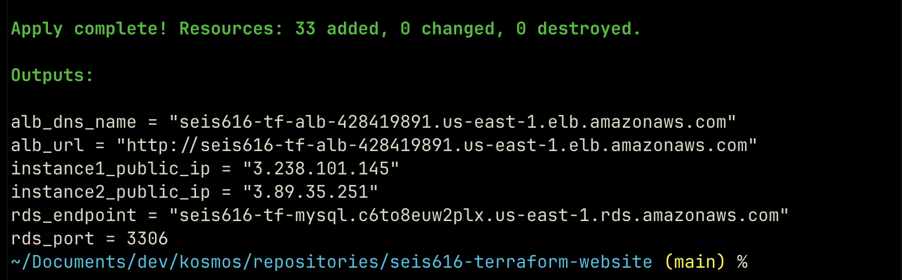
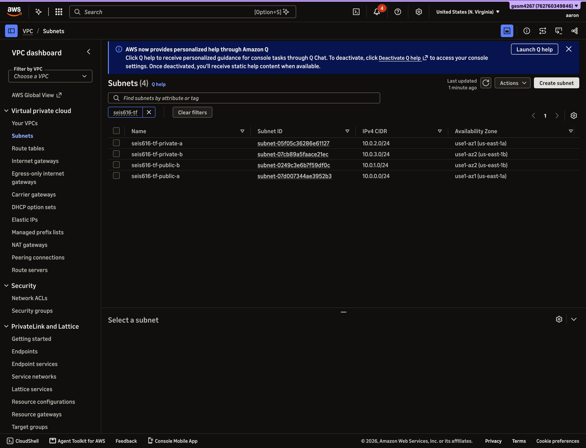
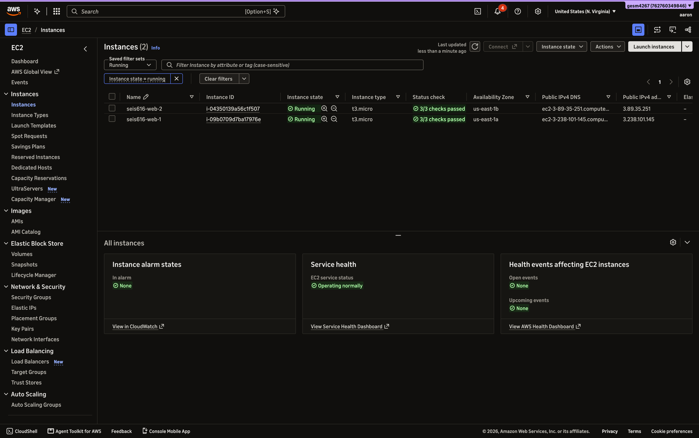
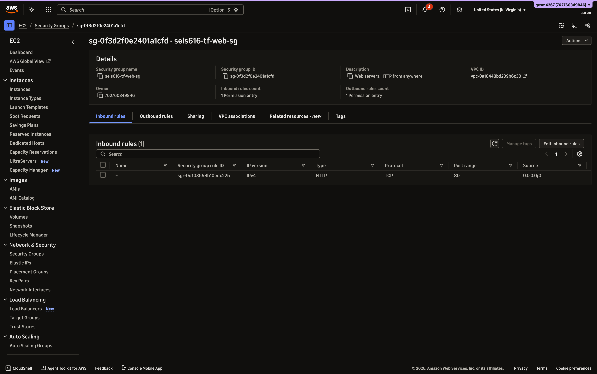
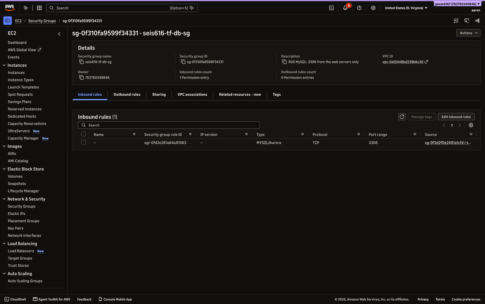
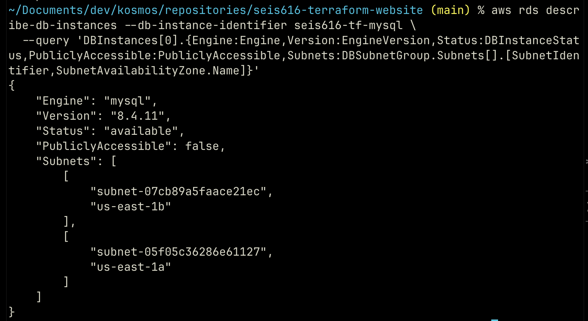
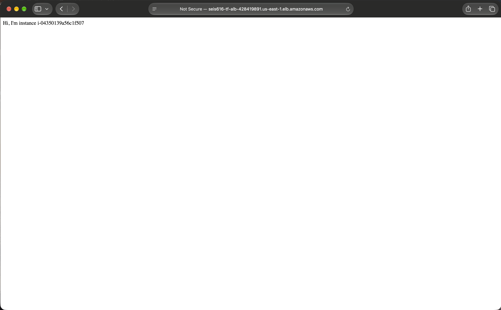
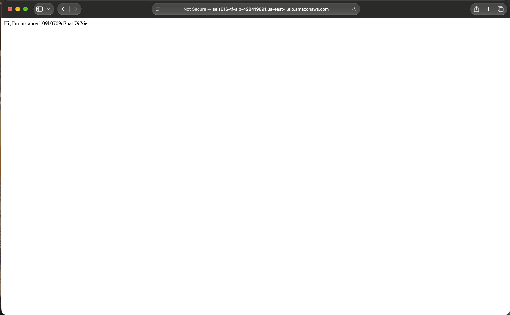
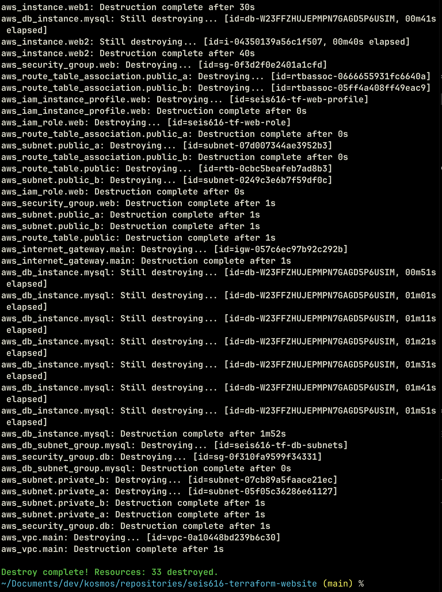

# Terraform Website on EC2

SEIS 616 Terraform homework. This configuration builds a small website in AWS:

```
Browser ──► Load balancer ──► seis616-web-1 (us-east-1a) ──┐
                         └──► seis616-web-2 (us-east-1b) ──┴──► MySQL database
```

- **Network:** one public and one private subnet in each of two Availability Zones.
- **Web servers:** one in each public subnet. Their names come from the input variables `instance1_name` and `instance2_name`, set in `terraform.tfvars`. They allow port 80 from anywhere.
- **Database:** MySQL in the private subnets. It allows port 3306 only from the web servers.
- **Load balancer:** sends visitors to both web servers.

Everything is in `main.tf`. The variables are in `variables.tf` and the outputs are in `outputs.tf`.

## Deploy

```bash
export AWS_PROFILE=<your-profile>
terraform init
terraform apply
```

Type `yes` when asked. It takes about 6 minutes. At the end it prints the outputs: each web server's public IP, the load balancer's address (`alb_url`), and the database endpoint.



## Verify

1. **VPC → Subnets:** four subnets, a public and a private one in each of us-east-1a and us-east-1b.

   

2. **EC2 → Instances:** `seis616-web-1` and `seis616-web-2` are running, one in each Availability Zone. These names come from `terraform.tfvars`.

   

3. **EC2 → Security Groups:** `seis616-tf-web-sg` allows port 80 from `0.0.0.0/0`. `seis616-tf-db-sg` allows port 3306 only from `seis616-tf-web-sg`.

   

   

4. **Database:** the RDS console doesn't show these settings together, so check them in the terminal. The database is MySQL, not publicly accessible, and uses the two private subnets.

   ```bash
   aws rds describe-db-instances --db-instance-identifier seis616-tf-mysql \
     --query 'DBInstances[0].{Engine:Engine,Version:EngineVersion,Status:DBInstanceStatus,PubliclyAccessible:PubliclyAccessible,Subnets:DBSubnetGroup.Subnets[].[SubnetIdentifier,SubnetAvailabilityZone.Name]}'
   ```

   

5. **Browser:** open `alb_url` + `/index.php`. It shows "Hi, I'm instance" and a server ID. Refresh and the ID changes, which shows the load balancer is using both servers.

   

   

## Tear down

```bash
terraform destroy
```

Type `yes` when asked.


